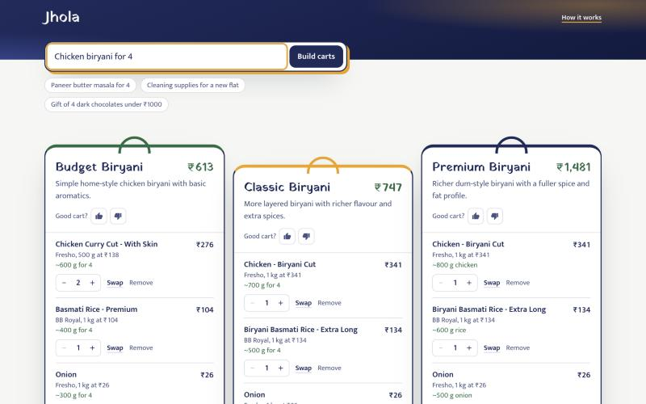
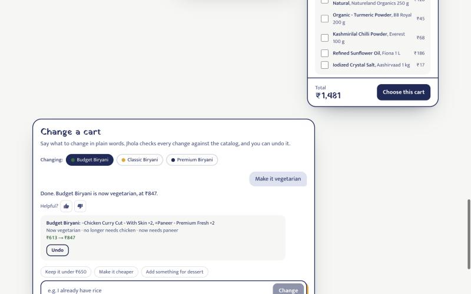
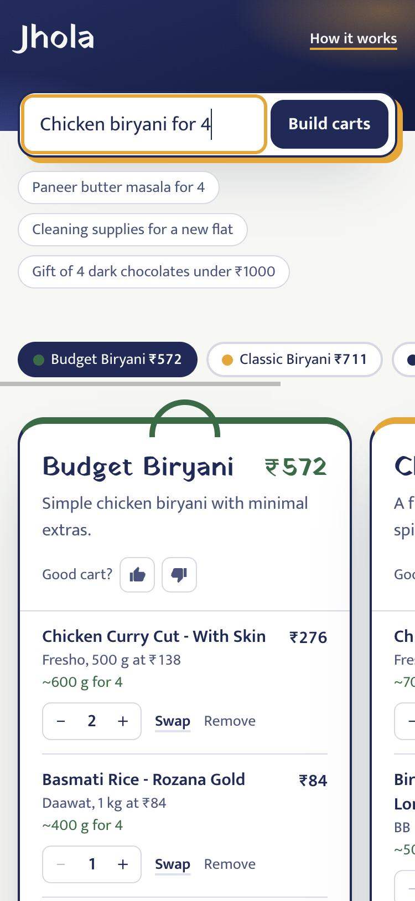
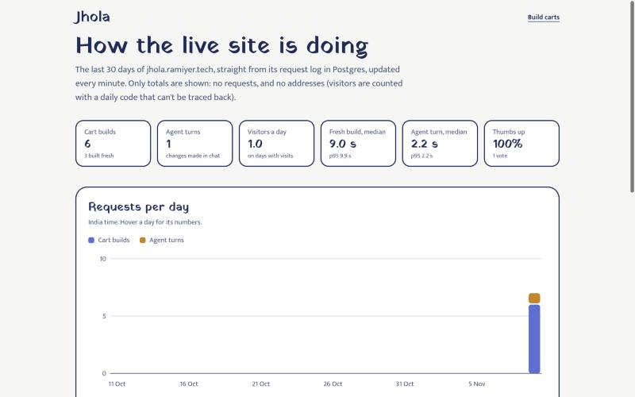
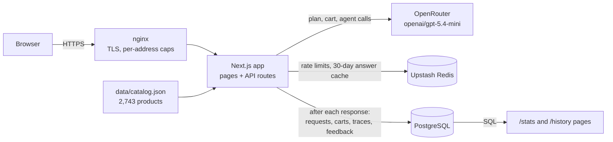
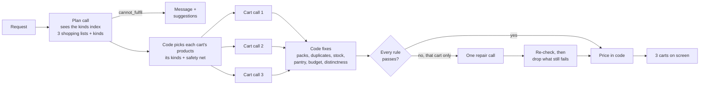
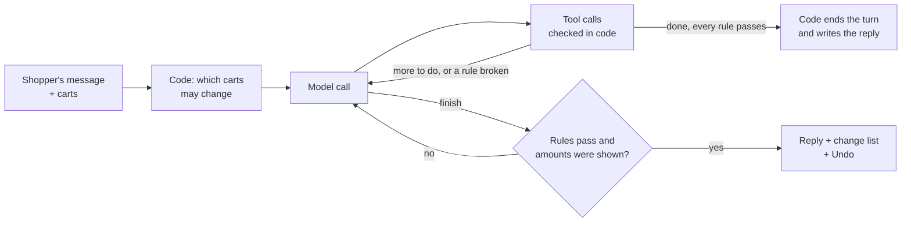

# Jhola: one line in, three ready carts out

Type a shopping request in plain language, like *"chicken biryani for 4"*, *"cleaning supplies for a new flat"* or *"healthy snacks under ₹300"*. Jhola builds three different, ready-to-order carts from 2,743 real Indian groceries and household essentials, with quantities and totals worked out. Then change any cart by asking: *"make it vegetarian"*, *"I already have rice"*, *"keep it under ₹450"*.

[](https://github.com/iyerbrah/Jhola/actions/workflows/ci.yml)
[](https://github.com/iyerbrah/Jhola/actions/workflows/eval.yml)
[](https://github.com/iyerbrah/Jhola/actions/workflows/deploy.yml)
[](https://jhola.ramiyer.tech/)
[](LICENSE)

**[Try the live demo →](https://jhola.ramiyer.tech/)** · [How it works](https://jhola.ramiyer.tech/how-it-works) · [Live stats](https://jhola.ramiyer.tech/stats) · Built by [Ram Iyer](https://github.com/iyerbrah)


## Highlights

- **The model picks, code counts.** An LLM chooses products and how much of each is needed. Code turns that into packs, prices and totals from the catalog, so an invented product or price can't reach the screen.
- **A tool-using agent edits the carts.** It works only through tools that check every argument. Code decides which carts it may change and won't let it finish while a rule is broken. Eval: 26 of 29 scripted conversations pass, with 0 rule breaks in every run.
- **Built to scale past the prompt.** The cart builder looks the catalog up in two steps (kinds first, then products), so growing the catalog 2.7× left the cost per answer about where it was (about $0.02).
- **Data you can query.** Every build and agent turn is logged in Postgres with a trace of each model and tool call. Shoppers rate answers 👍/👎, and a public [/stats](https://jhola.ramiyer.tech/stats) page computes speed, reliability and cost from the log in SQL.
- **Measured on every change.** A 35-request cart eval and a 29-scenario agent eval run against the real model. Every pull request runs a subset of each and fails if the scores drop below the saved baseline.
- **Shipped like a team.** Small PRs, CI on each one (lint, types, 292 tests including Postgres, catalog and contrast checks, a build), and an automatic deploy to its own server on merge.

**Stack:** Next.js (App Router) · TypeScript · Tailwind CSS · OpenAI `gpt-5.4-mini` through OpenRouter (structured outputs and tool calls) · Zod · PostgreSQL · Upstash Redis · Vitest · GitHub Actions · nginx + systemd on an Ubuntu VPS

| Ask in one line | Compare three carts | Change a cart by asking |
| --- | --- | --- |
|  |  |  |

| Works on a phone | Live stats from the request log |
| --- | --- |
|  |  |

## Architecture



- **`POST /api/build-carts`** builds three carts from a request (below).
- **`POST /api/agent`** runs one cart-editor turn and streams its steps as JSON lines.
- **`POST /api/feedback`** records a 👍/👎 on a cart or an agent reply.
- **Rate limits:** each endpoint has its own, counted in Redis.
- **Request log:** writes happen after the answer is sent, with short timeouts, so a slow or missing database never slows or breaks a request. Without `DATABASE_URL` the app keeps the log in memory instead.

## How the cart builder works

1. **Plan** (1 LLM call). The plan sees the rules plus a short index of the 362 kinds of product in stock: each kind's count, price range, typical price and two example names. It decides:
   - the status and any assumptions;
   - the constraints (budget, item count);
   - any main ingredient every cart must contain ("chicken biryani" → chicken);
   - three different carts from cheapest to priciest, each as a shopping list ("paneer 400 g; tomato 500 g; …") with the kinds it needs.
2. **Carts** (3 LLM calls in parallel). Each cart call sees only the products of its kinds: up to 16 per kind, the three cheapest packs plus a spread from cheapest to priciest per gram. It maps its list to product IDs and how much of each is needed (400 g, not "2 packs"). As a safety net, code adds the kinds of the named ingredients and the best search match for every shopping-list line. With a budget, each cart gets a spend limit (about 60%, 80% and 92% of it).
3. **Code does the maths and fixes what it can, instantly:**
   - pack counts come from the amount needed (400 g of 200 g packs = 2), and each item gets the cheapest pack size of that product that covers it (400 g of rice → a 1 kg bag, not 5 kg);
   - a product listed twice becomes one line, and an out-of-stock pick swaps to its closest in-stock twin;
   - pantry staples (salt, oil, turmeric…) become optional;
   - an over-budget cart swaps to cheaper packs of the same kind, never taking a pack off the dish's main ingredient;
   - two carts that are too alike swap shared items for other brands.
4. **Validate** every rule: real IDs, in stock, qty 1–10, budget, item count, the named main ingredient in every cart, and carts not too similar. Only a cart that still breaks a rule gets one repair call, with code's prices shown to the model.
5. **Price** in code from the catalog. The model never sets a price or total.



No call uses the model's "thinking" mode except a repair that must fix a budget or item count. Evals showed thinking added 2–5 s per call without better carts, because code already does the parts that need care.

## The cart editor agent

Under the carts, the shopper changes one in plain language. A tool-using agent makes the edits and code checks every one. The shopper sees each step as it happens ("Searching for paneer…"), then a change list ("−Chicken Curry Cut ×2, +Fresh Paneer ×4 · ₹683 → ₹540") with Undo and 👍/👎. Suggestion chips come from the cart itself: "Make it vegetarian" appears only when some food in it isn't. The design is in [docs/agent-plan.md](docs/agent-plan.md), the code in [lib/agent/](lib/agent/) and [components/CartChat.tsx](components/CartChat.tsx).

The same rule as the cart builder: **the model decides, code checks.**

- **Tools only.** The agent works through tools that validate every argument and take prices from the catalog: search, product details, add, remove, swap, quantity, requirements, `cheapen`, `fit_diet`, `check_rules` and `finish`.
- **Code does the mechanical edits.** `cheapen` runs the cart builder's own budget fitting, and `fit_diet` swaps items to fit a diet by kind. Swaps keep about the same amount, and a replaced main ingredient must be replaced by at least half its weight.
- **Scope is decided in code** from the shopper's words: the visible cart, unless they name another or say "all".
- **`finish` checks the work.** It's refused while a changed cart breaks a rule (stock, budget, diet, the dish's main ingredient, item counts). It also refuses a reply that mentions a rupee amount the agent was never shown.
- **Code ends clean turns.** When the model marks its last edit `done` and every rule passes, code ends the turn and writes the reply, saving a model call. After any refused call the model writes the reply, so it can say what couldn't be done.
- **Limits:** 16 tool calls, 6 model calls and 25 s per turn. A turn that hits one leaves the carts as they were.



## The data layer

| Table | One row per | Used for |
| --- | --- | --- |
| `requests` | cart build or agent turn: status, latency, tokens, cost, visitor, catalog size | `/stats`, `/history`, cost tracking |
| `carts`, `cart_items` | cart in a build, or a cart before and after an agent turn | seeing exactly what a shopper got |
| `trace_steps` | model or tool call in a request: name, attempt, ok, ms, tokens, error | finding the slow or failing step |
| `feedback` | 👍/👎 on a cart or a reply (one per visitor, can be changed or cleared) | the share of thumbs up, tied to the request it rates |

- **Schema:** `lib/db.ts` applies the schema on first use (create-if-missing, additive changes only), so deploys need no migration step.
- **Visitors:** counted as an HMAC of the address and the day. No raw IP is stored, and the code can't be linked across days.
- **`/stats`:** reads the log in SQL (median and p95 with `percentile_disc`, India-time days), and its numbers are tested against seeded rows.
- **Backups:** nightly `pg_dump`, keeping 7 days ([deploy/README.md](deploy/README.md)).

## The catalog

2,743 products: 1,719 food and 1,024 household items (personal care, cleaning, kitchen and home, baby care, pet care) in 363 kinds. They're built from a public BigBasket dataset by [scripts/catalog/build.ts](scripts/catalog/build.ts), whose rules are unit-tested on real rows.

- **Stable IDs.** [data/catalog/ids.json](data/catalog/ids.json) maps every source row to its ID, so a rebuild never renumbers products: saved carts, the request log and the agent eval keep working. New products are appended. A product whose row disappears stays, out of stock.
- **Misfilings caught by rules.** Each ingredient kind has a home category: cheese must be dairy, ghee must be oils and ghee. That fixed a chicken kabab filed as cheese, laddoos as ghee, Palakkad rice as spinach ("palak") and steamed rice as a drink ("steam" contains "tea").
- **A quality report on every build.** [data/catalog/report.json](data/catalog/report.json) lists rows dropped by reason (multipacks, bulk packs, price outliers, medicine and other things Jhola doesn't sell) and every keyword the misfiling guard skipped.
- **Diets apply to food only.** Non-food has no diet tags and fits every diet, so soap never makes a cart "not vegetarian". Diet searches leave out pet food, so a vegetarian swap never lands on chicken cat treats.

## Key decisions

- **IDs and amounts from the model, everything else from code.** Because the schema and ID checks accept only catalog products, even a reply bent by prompt injection can't put arbitrary content in a cart.
- **A two-step catalog lookup instead of the whole catalog in the prompt.** At 1,006 products the whole catalog fit, at about 31k tokens per call, mostly cached. At 2,743 it was 78k tokens per call and about $0.14 a build. Now the plan sees an index of kinds and each cart call sees only its kinds' products: about 13k tokens per call and about $0.02 a build.
- **One plan, three parallel carts, instead of one big call.** Each call writes a third of the output and they run at once, which roughly halved latency against a single call.
- **Mechanical work lives in code, not in prompts.** Duplicates, stock, pantry staples, budgets, near-identical carts, diet swaps and which carts an edit may touch are all decided by tested code. Repeatedly, a prompt-only fix didn't stick and a code check did.
- **The agent searches; it doesn't read the catalog.** A turn makes 1–3 model calls, so the agent uses a search tool instead of sending the catalog with each one.
- **Logging never sits on the request path.** Writes happen after the response, with 3 s timeouts. The log stays plain SQL tables, not an analytics service, so `/stats` is a few tested queries.
- **Limits ship with the public link.**
  - Cart builds: 10 per person per hour and 300 a day.
  - Agent turns: 30 per person per hour and 600 a day.
  - Repeated questions come from a 30-day answer cache.
  - The counts live in Upstash Redis, so they survive restarts and deploys, and nginx adds a per-address cap on both APIs that holds even if Redis is unreachable.
- **A small VPS instead of serverless.** One long-running Node.js process behind nginx, with Postgres on the same machine: no function time limits, no per-request billing.

## Evaluation

### Cart builder

`npm run eval` runs 35 requests through the real pipeline, each with its own checks in [evals/queries.json](evals/queries.json):
- 10 recipes;
- 8 meal ideas;
- 7 budget or gift requests;
- 5 household requests: cleaning supplies, toiletries for a trip, newborn essentials, a restock under ₹800, groceries and cleaning under ₹2,500;
- 5 edge cases: unavailable ingredients, a laptop, a one-word query, a 261-character query and a prompt injection.

Results are saved to [evals/results/](evals/results/).

Latest run (Nov 9, 2026, gpt-5.4-mini called on OpenAI directly, before the move to OpenRouter; 2,743 products, one query at a time from a home connection in India):

| Metric | How it's measured | Result | Target |
| --- | --- | --- | --- |
| Valid on first try | Passes every rule with no repair call | 94% | report |
| Valid after repair | Passes every rule after at most one repair | **97%** | ≥ 90% |
| Constraints met | Budget and item-count rules hold in all 3 carts | **100%** | ≥ 90% |
| Ingredient coverage | Share of required item groups found in each cart | **99%** | ≥ 90% |
| Variant distinctness | Mean pairwise Jaccard on product IDs (lower = more different) | **0.29** | < 0.60 |
| Correct status | Edge cases get the expected status | **5 of 5** | 5 of 5 |
| Latency | p50 / p95 per query | 8.8 s / 17.6 s | p95 < 8 s |
| Cost | Average per query, from token counts and gpt-5.4-mini list prices | $0.017 (about ₹1.5) | report |

Latency misses its target. Each query makes 2–3 back-to-back calls from India to the model's US servers, and their speed varies a lot. On 9 Nov the code from before the catalog grew, run side by side with this code, was just as slow: 8–10 s per build. Two weeks earlier the same old code measured 5.4 s / 8.5 s. The live server's own timings are on [/stats](https://jhola.ramiyer.tech/stats).

<details>
<summary><b>What each change improved</b> (one full run per change)</summary>

Results move by a query or two between runs, so a single run's changes are signals, not proof.

| Change | First try | After repair | Constraints | Edge | p50 / p95 | Cost |
| --- | --- | --- | --- | --- | --- | --- |
| Baseline: plan + 3 parallel carts, 980 products | 80% | 83% | 86% | 4/5 | 6.2 / 12.4 s | $0.020 |
| Own groups for each dish masala and green tea; "packaging isn't a missing item"; plan without thinking | 83% | 100% | 100% | 5/5 | 5.8 / 11.9 s | $0.017 |
| Repairs without thinking; carts told to stay true to their tier | 90% | 93% | 86% | 5/5 | 5.9 / 7.3 s | $0.016 |
| Repairs think only for budget/count fixes; clearer "N different X" counts | 90% | 90% | 100% | 4/5 | 6.1 / 8.2 s | $0.018 |
| Code makes too-similar carts distinct; vague-query rule | 90% | 93% | 100% | 4/5 | 5.8 / 10.5 s | $0.018 |
| Code merges duplicate lines and replaces out-of-stock picks; narrower vague rule | 93% | 97% | 100% | 5/5 | 6.0 / 8.7 s | $0.017 |
| Each cart gets its own spend limit when there's a budget | 93% | 97% | 100% | 4/5 | 5.5 / 7.3 s | $0.016 |
| Explicit "not a shopping request → cannot_fulfil" rule | 97% | 100% | 100% | 5/5 | 4.3 / 5.4 s | $0.017 |
| Code computes pack counts from the amount needed; amount hints for butter, cream and oil | 97% | 100% | 100% | 5/5 | 6.2 / 8.4 s | $0.019 |
| Cheapest pack size per item; named main ingredient checked in every cart; each cart told its price position; cleaner product names | 93% | 100% | 100% | 5/5 | 5.4 / 8.5 s | $0.017 |
| *35 queries from here (5 household).* 2,743 products, two-step catalog lookup | 86% | 94% | 100% | 5/5 | 8.2 / 14.1 s | $0.019 |
| Budget carts: three cheapest packs per kind, typical prices in the kinds index, leave out lines rather than go over | 91% | 97% | 100% | 5/5 | 9.1 / 21.7 s\* | $0.016 |
| Budget fitting never takes a pack off the main ingredient | 94% | **100%** | 100% | 5/5 | 8.4 / 13.8 s | $0.016 |
| Plain chicken and mutton cuts apart from offal and ready-to-cook | 94% | 97% | 100% | 5/5 | 8.8 / 17.6 s | $0.017 |

\* Ran at the same time as another eval, so its latency is inflated.

The biggest wins came from moving mechanical fixes (duplicates, budgets, near-identical carts) out of the model and into code: they're instant, deterministic and testable, and they cut repair calls from 5 of 30 to 1 of 30.

</details>

### Cart editor agent

`npm run eval:agent` plays 29 scripted conversations from saved carts and checks the final carts in code. They cover:
- diets, including a biryani cart with cleaning items that must stay;
- budgets, and things the shopper already has;
- adding and swapping, including a toothpaste added to a paneer cart;
- quantities;
- questions;
- impossible requests, including a prompt injection;
- two-turn chats.

Latest run (Nov 9, 2026, on OpenAI directly, before the move to OpenRouter): **90% (26 of 29)** task success, **0** rule breaks in changed carts, **0** scenarios that changed the wrong cart, 4 of 4 questions and impossible requests that changed nothing, 4.4 s / 12.9 s per turn (p50 / p95), $0.0039 per turn.

<details>
<summary><b>What each change improved</b> (27 scenarios until the *29 scenarios* row)</summary>

| Change | Task success | Wrong cart changed | Turns that gave up | p50 / p95 per turn | Cost per turn |
| --- | --- | --- | --- | --- | --- |
| First version | 63% (17/27) | 3 | 6 of 29 | 4.7 / 9.2 s | $0.0036 |
| Identical calls in one response share a result, instead of counting as "going in circles" | 74% | 1 | 4 | 5.2 / 10.9 s | $0.0048 |
| Code decides which carts a turn may change | 78% | **0** | 4 | 5.5 / 10.0 s | $0.0058 |
| `cheapen` tool (the cart builder's own budget fitting), limits 12 tool / 6 model calls | 85% | 0 | 1 | 3.8 / 11.5 s | $0.0051 |
| A dropped ingredient must name its replacement; replies can't state amounts the agent wasn't shown | 81% | 0 | 2 | 4.1 / 11.6 s | $0.0050 |
| Diet changes can't skip the replacement; fewer rounds per turn | 85% | 0 | 3 | 4.0 / 13.2 s | $0.0058 |
| `fit_diet` tool: code swaps items to fit a diet by kind, the model handles the rest | **93% (25/27)**, twice | 0 | 1 | 4.1 / 11.3 s | $0.0041 |
| *The eval starts checking amounts: a replaced main ingredient must be at least 40% of its weight* | 81% | 0 | 3 | 4.5 / 11.8 s | $0.0048 |
| Swaps keep about the same amount in code (900 g chicken → 5 × 200 g paneer) | 89% | 0 | 2 | 4.3 / 11.1 s | $0.0050 |
| A turn ends in code once its edits pass every rule, instead of a model call for `finish` | 89% | 0 | 1 | 3.3 / 9.0 s | $0.0032 |
| `cheapen` records the budget it reaches | 93% | 0 | 0 | 3.3 / 11.3 s | $0.0036 |
| A replacement must be at least half the amount it replaces (a rule `finish` checks) | 85% | 0 | 2 | 3.6 / 12.6 s | $0.0032 |
| The model marks its last edit `done`; code writes the reply only for a clean turn | 89–93% over two runs | 0–1 | 1 | **2.3** / 11.6–14.4 s | $0.0028–0.0037 |
| *29 scenarios.* 2,743 products; diets apply to food only | 90% (26/29) | 0 | 2 of 31 | 3.9 / 12.6 s | $0.0040 |
| `cheapen` never takes a pack off the main ingredient | 79% (23/29) | 1 | 4 of 31 | 4.4 / 14.1 s | $0.0051 |
| A named budget is recorded once removals reach it; plain meat cuts | **90% (26/29)** | 0 | 1 of 31 | 4.4 / 12.9 s | $0.0039 |

Across every run there were **0 rule breaks** in changed carts. Questions, a laptop charger and the prompt injection changed nothing. Not spending a model call on `finish` when code can confirm the edits halved the median turn: one model call takes over a second even for "Say OK", so fewer model calls is the speed lever.

Still open:
- **"make it cheaper" on a chicken biryani:** it finds only about 7%, because it won't cut the chicken (the eval wants 10%);
- **grocery-list budgets:** it trims optional extras but stops before staples, and says so;
- **a vegan paneer dish:** the agent runs out of steps;
- **p95 latency:** 11–14 s, over the 10 s goal; the slowest turns are diet changes that take 5–6 model calls.

</details>

### The eval checks on pull requests

Every PR that touches the pipeline, prompts, catalog, eval code or dependencies runs two checks against the real model and posts one comment with the scores:
- **cart builder:** 11 requests marked `"ci": true`, covering every group;
- **agent:** 6 scenarios.

A check fails when:
- any query breaks a rule (after one re-run to rule out a fluke);
- ingredient coverage drops more than 8 points below the baseline or under 90%;
- carts get more alike;
- cost per query rises more than 50%;
- the agent breaks a rule or passes fewer than 5 of its 6 scenarios.

Latency is reported but never fails a check, since GitHub's runners aren't the live server. The baselines are [evals/baseline.json](evals/baseline.json) and [evals/agent/baseline.json](evals/agent/baseline.json). A PR that deliberately moves the numbers updates them, so the change is visible in review.

## Known limitations

- **Prices** are a past snapshot. About 50 everyday items (fresh fruit and vegetables, a few dark chocolates) were added by hand with illustrative prices because the dataset lacks them.
- **Stock** is simulated: about 5% of products are marked out of stock so substitutions show up.
- **Amounts** are the model's judgement. Code makes the pack counts match the amounts, but a "premium" cart can still pick big packs: the premium cleaning kit comes to about ₹9,000 with a ₹2,999 spin mop.
- **Recipes** can still miss a secondary ingredient, which the eval's ingredient coverage shows.
- **Latency** depends on the model provider's load and the distance to its servers: the same queries ran in 5 s on one day and 9 s on another.
- **It's a demo:** one catalog, one store, no login, and checkout places no order.

## Repository tour

| Path | What's there |
| --- | --- |
| [`lib/buildCarts.ts`](lib/buildCarts.ts) | The cart builder: plan, parallel cart calls, code fixes, validation, one repair, pricing |
| [`lib/prompt.ts`](lib/prompt.ts), [`lib/cartProducts.ts`](lib/cartProducts.ts) | The prompts, the kinds index, and which products each cart call sees |
| [`lib/validate.ts`](lib/validate.ts), [`lib/tidy.ts`](lib/tidy.ts), [`lib/budget.ts`](lib/budget.ts), [`lib/diversify.ts`](lib/diversify.ts) | The rules every cart must pass, and the fixes code makes itself |
| [`lib/agent/`](lib/agent/) | The cart editor agent: tools, loop and limits, search, scope, streaming API |
| [`lib/db.ts`](lib/db.ts), [`lib/requestLog.ts`](lib/requestLog.ts), [`lib/stats.ts`](lib/stats.ts) | The Postgres schema, the request log, and the SQL behind `/stats` |
| [`scripts/catalog/build.ts`](scripts/catalog/build.ts) | The catalog pipeline: kinds, quality checks, stable IDs, report |
| [`app/`](app/), [`components/`](components/) | Pages, API routes and the UI |
| [`evals/`](evals/) | Both evals, their scoring, baselines and every saved run |
| [`tests/`](tests/) | 292 tests: fake-model unit tests, Postgres integration tests, pipeline fixtures |
| [`deploy/`](deploy/) | Server setup, the deploy script, nginx and systemd config, and the runbook |
| [`.github/workflows/`](.github/workflows/) | CI, the eval check on PRs, and deploy on merge |

**More documentation:**
- [deploy/README.md](deploy/README.md): running the server.
- [docs/agent-plan.md](docs/agent-plan.md): the agent's design and what changed from it.
- [SPEC.md](SPEC.md): the original product spec.

## Run locally

You need Node.js 20 or newer (the live server uses Node 24).

```bash
npm ci
cp .env.example .env         # then add your OpenRouter key
npm run dev                  # http://localhost:3000
```

**Optional services:**
- **Redis:** locally, rate limits are off and there is no cache unless you add Upstash values to `.env`.
- **Postgres:** without `DATABASE_URL`, the request log is kept in memory, so `/history` works until you restart and `/stats` shows an empty state. To try Postgres locally, point `DATABASE_URL` at any database; the app creates its tables itself.

Don't run `npm run build` while the dev server is running: both use the `.next` folder.

```bash
npm test                          # unit tests (no API calls; Postgres tests run when TEST_DATABASE_URL is set)
npm run typecheck                 # TypeScript (CI also runs lint, tests, the catalog and contrast checks and a build)
npm run eval                      # the 35-query cart eval (about 6 min, about $0.60)
npm run eval -- --group=household # one group only
npm run eval:ci                   # the 11-query PR check against evals/baseline.json (about $0.17)
npm run eval:agent                # the 29-scenario agent eval (about $0.13)
npm run eval:agent -- --ci        # its 6-scenario PR check (about $0.02)
npm run try -- "poha for 3"       # one query through the real pipeline (DEBUG_CARTS=1 shows repairs)
npm run try:agent -- "chicken biryani for 4" "make it vegetarian"
npm run catalog:build             # rebuild the catalog from data/raw/bigbasket.csv (keeps IDs stable)
npm run catalog:check             # check the catalog covers the promised dishes
npm run check:contrast            # check every UI colour pair against WCAG AA
npm run warm                      # pre-build the example chips' answers into the shared cache
```

## Deploy

The live site, [jhola.ramiyer.tech](https://jhola.ramiyer.tech), runs on an Ubuntu VPS: nginx with a Let's Encrypt certificate in front, the Next.js app as a systemd service, PostgreSQL on the same machine, and Upstash Redis.

- **Merging a pull request deploys it.** Once CI passes on `main`, a GitHub Actions workflow SSHes in with a key that can run only one script, `jhola-deploy <commit>`.
- **What that script does:** it fetches the commit, refuses anything not on `main`, builds as an unprivileged user, restarts the app and checks it answers.
- **Rolling back** is the same workflow run with an older commit.

[deploy/README.md](deploy/README.md) covers:
- day-to-day tasks and rollbacks;
- the request log and its backups;
- setting up a new server, step by step;
- fixes for the problems hit along the way.

## Data

The code is under the [MIT license](LICENSE). Product data comes from the Kaggle dataset ["BigBasket Products"](https://www.kaggle.com/datasets/chinmayshanbhag/big-basket-products) by Chinmay Shanbhag (CC0, public domain), plus about 50 hand-added staples with illustrative prices. Prices are a past snapshot. Jhola is a portfolio project and isn't affiliated with any retailer.
