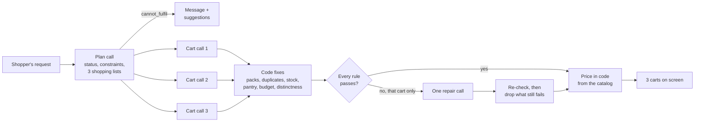

# Jhola: one line in, three ready carts out

Type any grocery request in plain language, like *"chicken biryani for 4"* or *"healthy snacks under ₹300"*, and get three different, ready-to-order carts built from 1,006 real Indian grocery products, with quantities and totals worked out.

[](https://github.com/iyerbrah/Jhola/actions/workflows/ci.yml)

**[Try the live demo →](https://jhola.ramiyer.tech/)** · [How it works](https://jhola.ramiyer.tech/how-it-works) · Built by [Ram Iyer](https://github.com/iyerbrah)


## Highlights

- **The model picks, code counts.** An LLM chooses products and how much of each is needed; code turns that into packs, prices and totals from the catalog, so an invented product or price can't reach the screen.
- **Fast by design.** One planning call, then three cart calls in parallel, with mechanical fixes (pack sizes, duplicates, stock, budgets, near-identical carts) done instantly in code rather than in extra model calls. Typical answer: about 5–6 s.
- **Measured.** A 30-query eval (recipes, meal ideas, budget and gift requests, edge cases including a prompt injection) scores every answer in code. Every quality target in the spec passes; results and the history of what each change improved are below.
- **Cheap to run.** About ₹1.5 per answer, thanks to prompt caching. Rate limits and a 30-day answer cache in Upstash Redis keep a public link safe.
- **Tested.** 80+ unit tests with fake model answers (no live API calls), WCAG AA colour contrast checked in code, and a mobile-first UI.

**Stack:** Next.js (App Router) · TypeScript · Tailwind CSS · OpenAI `gpt-5.4-mini` with structured outputs · Zod · Upstash Redis · Vitest · nginx + systemd on an Ubuntu VPS

| Ask in one line | Compare three carts | Works on a phone |
| --- | --- | --- |
|  |  |  |

The original product spec is in [SPEC.md](SPEC.md).

## How it works

1. **Plan** (1 LLM call): decide the status, assumptions, constraints (budget, item count), any main ingredient every cart must contain ("chicken biryani" → chicken), and 3 different carts from cheapest to priciest, each as a plain shopping list ("paneer 400 g; tomato 500 g; …").
2. **Carts** (3 LLM calls in parallel): map each shopping list to catalog product IDs and say how much of each is needed (e.g. 400 g). Each call knows its place in the price order, and with a budget gets its own spend limit (about 60%, 80% and 92% of the budget).
3. **Code does the maths and fixes what it can, instantly:**
   - pack counts come from the amount needed (400 g of 200 g packs = 2 packs), not from the model, and each item gets the cheapest pack size of that product that covers it (400 g of rice → a 1 kg bag, not 5 kg);
   - the same product listed twice becomes one line, and an out-of-stock pick swaps to its closest in-stock twin;
   - pantry staples (salt, oil, turmeric…) become optional;
   - an over-budget cart swaps to cheaper packs of the same kind;
   - two carts that are too alike swap shared items for other brands.
4. **Validate** every rule (real IDs, in stock, qty 1–10, budget, item count, the named main ingredient in every cart, carts not too similar). Only a cart that still breaks a rule gets one repair call, with code's prices shown to the model.
5. **Price** in code from the catalog. The model never sets a price or total.

No call uses the model's "thinking" mode, except a repair that has to fix a budget or item count. Evals showed thinking added 2–5 s per call without better carts, because code already does the parts that need care. Each cart call writes a third of the output and all three run at once, and every call shares the same cached prompt prefix (rules + catalog), which keeps cost low.



## Key decisions

- **The model picks, code counts.** The LLM returns product IDs and how much of each is needed; code computes packs, prices and totals from the catalog. A wrong or invented price can't reach the screen, and the schema plus ID checks mean a prompt-injection reply can't put arbitrary content in a cart.
- **The whole catalog goes in the prompt.** At about 1,000 products it is roughly 21k tokens, and OpenAI's prompt caching bills about 95% of it at the cached rate, so a query costs about $0.02. Search or embeddings only become worth it when the catalog stops fitting.
- **One plan, three parallel carts, instead of one big call.** Each call writes a third of the output and they run at once, which roughly halved latency against a single call.
- **Mechanical fixes live in code, not in repair prompts.** Duplicate lines, out-of-stock picks, pantry staples, budgets and near-identical carts are fixed deterministically and unit-tested. Only what code can't fix goes back to the model.
- **Limits ship with the public link.** 10 requests per person per hour and 300 a day, counted in Upstash Redis so they survive restarts and deploys, plus a 30-day cache for repeated questions. nginx adds a looser per-address cap on the cart API, which still holds if Upstash is ever unreachable.
- **A small VPS instead of serverless.** The app first ran on Vercel and moved to its own Ubuntu server: one long-running Node.js process behind nginx, with no function time limits or per-request billing. Upstash stayed, so the cache and history carried over unchanged.

## Known limitations

- Prices are a past snapshot, and about 50 everyday items (fresh fruit and vegetables, some dark chocolates) were added by hand with illustrative prices because the dataset lacks them.
- Stock is simulated: about 4% of products are marked out of stock so substitutions show up.
- Recipes can still miss a secondary ingredient (for example, chole bhature carts skipping the maida for the bhature), which the eval's ingredient coverage (97%) reflects.
- Amounts are the model's judgement. Code makes the pack counts match the amounts, but a plan can still ask for more of something than a cook would (for example a large butter pack in a "premium" cart).
- One catalog, one store, no login, and checkout is a demo: nothing is ordered or charged.
- Latency depends on OpenAI's load; it ranged from about 4 s to 9 s for the same queries on the same day.

## Evaluation

`npm run eval` runs 30 queries through the real pipeline: 10 recipes, 8 meal ideas, 7 budget or gift requests and 5 edge cases (unavailable ingredients, a non-grocery request, a one-word query, a 261-character query and a prompt-injection attempt). Each query has its own checks in [evals/queries.json](evals/queries.json), and results are saved to [evals/results/](evals/results/).

Latest run (gpt-5.4-mini, 1,006 products, queries run one at a time from a home connection in India):

| Metric | How it's measured | Result | Target |
| --- | --- | --- | --- |
| Valid on first try | Passes every rule with no repair call | 93% | report |
| Valid after repair | Passes every rule after at most one repair | **100%** | ≥ 90% |
| Constraints met | Budget and item-count rules hold in all 3 carts | **100%** | ≥ 90% |
| Ingredient coverage | Share of required ingredient groups found in each cart | **97%** | ≥ 90% |
| Variant distinctness | Mean pairwise Jaccard on product IDs (lower = more different) | **0.25** | < 0.60 |
| Correct status | Edge cases get the expected status | **5 of 5** | 5 of 5 |
| Latency | p50 / p95 per query | 5.4 s / 8.5 s | p95 < 8 s |
| Cost | Average per query, from token counts and OpenAI list prices | $0.017 (about ₹1.5) | report |

Latency is the one target this run misses, by 0.5 s: the p95 of 30 queries is the second-slowest query, and the two slowest were the two that needed a repair call. Without a repair, every query finished within 8 s. Latency also swings with OpenAI's load: an earlier run with nearly the same code measured 4.3 s / 5.4 s. These runs also cross from India to OpenAI's US servers for each of the 2–3 back-to-back calls, so the live site's speed depends on where its server is relative to OpenAI.

### What each change improved

Each row is one full 30-query run after a change. Results move by a query or two between runs, so a single run's changes are signals, not proof.

| Change | First try | After repair | Constraints | Edge | p50 / p95 | Cost |
| --- | --- | --- | --- | --- | --- | --- |
| Baseline: plan + 3 parallel carts, 980 products | 80% | 83% | 86% | 4/5 | 6.2 / 12.4 s | $0.020 |
| Own groups for each dish masala and green tea; "packaging isn't a missing item"; plan without thinking | 83% | 100% | 100% | 5/5 | 5.8 / 11.9 s | $0.017 |
| Repairs without thinking; carts told to stay true to their tier | 90% | 93% | 86% | 5/5 | 5.9 / 7.3 s | $0.016 |
| Repairs think only for budget/count fixes; clearer "N different X" counts | 90% | 90% | 100% | 4/5 | 6.1 / 8.2 s | $0.018 |
| Code makes too-similar carts distinct; vague-query rule | 90% | 93% | 100% | 4/5 | 5.8 / 10.5 s | $0.018 |
| Code merges duplicate lines and replaces out-of-stock picks; narrower vague rule | 93% | 97% | 100% | 5/5 | 6.0 / 8.7 s | $0.017 |
| Each cart gets its own spend limit when there's a budget | 93% | 97% | 100% | 4/5 | 5.5 / 7.3 s | $0.016 |
| Explicit "not a shopping request → cannot_fulfil" rule | 97% | 100% | 100% | 5/5 | 4.3 / 5.4 s | $0.017 |
| Code computes pack counts from the amount needed; amount hints for butter, cream and oil | 97% | 100% | 100% | 5/5 | 6.2 / 8.4 s | $0.019 |
| Cheapest pack size per item; named main ingredient checked in every cart; each cart told its price position; cleaner product names | 93% | 100% | 100% | 5/5 | 5.4 / 8.5 s | $0.017 |

The biggest wins came from moving mechanical fixes (duplicates, budgets, near-identical carts) out of the model and into code: they're instant, deterministic and testable, and they cut repair calls from 5 of 30 (second run) to 1 of 30. Latency also depends on OpenAI's load at the time; the same query took 5–6 s in the morning and 8–15 s in the afternoon of the same day.

### The eval check on pull requests

Every PR that touches the pipeline, prompts, catalog, eval code or dependencies runs a 9-query subset of the eval against the real model (the queries marked `"ci": true`, covering all four groups) and comments the scores on the PR. It fails when:

- any query breaks a rule (fake or out-of-stock item, wrong price, over budget, wrong item count, carts too alike, wrong status), after one re-run to rule out a fluke;
- ingredient coverage drops more than 8 points below the baseline, or under the 90% target;
- carts get more alike (mean Jaccard up by more than 0.10, or over 0.60);
- average cost per query rises more than 50%.

Latency is shown but never fails the check, since GitHub's runners aren't the live server. The baseline lives in [evals/baseline.json](evals/baseline.json); a PR that deliberately moves the numbers updates it with `npm run eval:ci -- --update-baseline`, so the change is visible in review. Every PR, whatever it touches, also runs lint, typecheck, unit tests, the catalog and contrast checks and a build.

## The cart editor agent

Under the carts, the shopper can change one in plain language: *"make it vegetarian"*, *"keep it under ₹450"*, *"I already have rice"*. A tool-using agent makes the edits, code checks every one, and the shopper sees each step as it happens ("Searching for paneer…"), then a change list ("−Chicken Curry Cut ×2, +Fresh Paneer ×4 · ₹683 → ₹540") with an Undo. Suggestion chips come from the cart itself: "Make it vegetarian" appears only when something in it isn't. The design is in [docs/agent-plan.md](docs/agent-plan.md), the code in [lib/agent/](lib/agent/) and [components/CartChat.tsx](components/CartChat.tsx), and the endpoint is `POST /api/agent`, which streams JSON lines and has its own rate limit (30 turns an hour per person).

The same rule as the cart builder: **the model decides, code checks.**
- The agent works only through tools (search, add, remove, swap, quantity, requirements, `cheapen`, `fit_diet`, `finish`) that validate every argument and take prices from the catalog.
- Which carts it may change is decided in code from the shopper's words: the visible cart, unless they name another or say "all".
- `finish` is refused while a changed cart breaks a rule (stock, budget, diet, the dish's main ingredient, item counts).
- `finish` also refuses a reply that mentions a rupee amount the agent was never shown, so it can't claim a total it didn't reach.
- Swaps keep about the same amount, and a replaced main ingredient must be replaced by at least half its weight.
- When the model marks its last edit `done` and code confirms every rule passes, code ends the turn and writes the reply from the carts, saving a model call. After any refused call the model writes the reply, so it can say what couldn't be done.
- Limits of 16 tool calls, 6 model calls and 25 s per turn. A turn that hits one leaves the carts as they were.

`npm run eval:agent` plays 27 scripted conversations from saved carts (diet, budget, things the shopper has, adding, swaps and quantities, questions, impossible requests including a prompt injection, and two-turn chats) and checks the final carts in code.

| Change | Task success | Wrong cart changed | Turns that gave up | p50 / p95 per turn | Cost per turn |
| --- | --- | --- | --- | --- | --- |
| First version | 63% (17/27) | 3 | 6 of 29 | 4.7 / 9.2 s | $0.0036 |
| Identical calls in one response share a result, instead of counting as "going in circles" | 74% | 1 | 4 | 5.2 / 10.9 s | $0.0048 |
| Code decides which carts a turn may change | 78% | **0** | 4 | 5.5 / 10.0 s | $0.0058 |
| `cheapen` tool (the cart builder's own budget fitting), limits 12 tool / 6 model calls | 85% | 0 | 1 | 3.8 / 11.5 s | $0.0051 |
| A dropped ingredient must name its replacement; replies can't state amounts the agent wasn't shown | 81% | 0 | 2 | 4.1 / 11.6 s | $0.0050 |
| Diet changes can't skip the replacement; fewer rounds per turn | 85% | 0 | 3 | 4.0 / 13.2 s | $0.0058 |
| `fit_diet` tool: code swaps items to fit a diet by kind, the model handles the rest | **93% (25/27)**, twice | 0 | 1 | 4.1 / 11.3 s | $0.0041 |
| *The eval starts checking amounts: a replaced main ingredient must be at least 40% of its weight* | 81% | 0 | 3 | 4.5 / 11.8 s | $0.0048 |
| Swaps keep about the same amount in code (900 g chicken → 5 × 200 g paneer) | 89% | 0 | 2 | 4.3 / 11.1 s | $0.0050 |
| *Tried and dropped: asking the model to call `finish` with its last edits (no change, 2.7 model calls per turn)* | 89% | 0 | 2 | 4.0 / 10.5 s | $0.0053 |
| A turn ends in code once its edits pass every rule, instead of a model call for `finish` | 89% | 0 | 1 | 3.3 / 9.0 s | $0.0032 |
| `cheapen` records the budget it reaches | 93% | 0 | 0 | 3.3 / 11.3 s | $0.0036 |
| A replacement must be at least half the amount it replaces (a rule `finish` checks) | 85% | 0 | 2 | 3.6 / 12.6 s | $0.0032 |
| The model marks its last edit `done` (code ending turns had cut off "atta and moong dal"); code writes the reply only for a clean turn | **89–93%** over two runs | 0–1 | 1 | **2.3** / 11.6–14.4 s | $0.0028–0.0037 |

Across every run: **0 rule breaks** in changed carts, and questions, a laptop charger and the prompt injection changed nothing. The second round of changes halved the median turn (about 4.2 s → 2.3 s) and cut cost per turn by a third, mostly by not spending a model call on `finish` when code can confirm the edits are done. One OpenAI test call takes over a second even for "Say OK", so fewer model calls is the speed lever; OpenAI's priority tier was within noise in one eval run (`LLM_AGENT_SERVICE_TIER`, off by default). One run in this round isn't in the table: every turn running at that moment stalled for 83 s at the same time (the process was paused), and a rerun was clean. As with the cart builder, the biggest gains came from moving mechanical work (budget fitting, diet swaps, which carts may change) out of the model and into code. Two fixes to the eval's own checks landed mid-way (curly apostrophes before the fifth row, "couldn't" before the sixth), so from those rows on, the impossible-budget reply is scored more fairly than in the rows above. Still open: grocery-list budgets (it trims optional extras but stops before staples, and now says so), the impossible-budget case (about half the runs it trims the pav bhaji instead of saying no), and p95 latency (11–14 s, over the 10 s goal: the slowest turns are diet changes that still take 5–6 model calls).

## Run locally

You need Node.js 20 or newer (the live server uses Node 24).

```bash
npm ci
cp .env.example .env.local   # then add your OPENAI_API_KEY
npm run dev                  # http://localhost:3000
```

On a Mac you can instead double-click `start-jhola.command`: it starts the dev server and opens the site in Safari. Locally, rate limits are off and there is no cache unless you add Upstash values to `.env.local`.

Don't run `npm run build` while the dev server is running: both use the `.next` folder, and the dev server breaks until restarted.

Other commands:

```bash
npm test                          # unit tests (no API calls)
npm run typecheck                 # TypeScript check (CI also runs lint, tests, the two checks below and a build)
npm run eval                      # run the 30-query eval (about 5 min, about $0.50)
npm run eval -- --group=edge      # one group only
npm run eval:ci                   # the 9-query PR check against evals/baseline.json (about $0.15)
npm run eval:agent                # the cart editor agent's 27-scenario eval (about $0.15)
npm run eval:agent -- --ci        # its 6-scenario PR check against evals/agent/baseline.json (about $0.03)
npm run try:agent -- "chicken biryani for 4" "make it vegetarian"   # try the agent on real carts
npm run try                       # run the 3 example queries against the real model
npm run try -- "poha for 3"       # run your own query
DEBUG_CARTS=1 npm run try         # also print which rules triggered a repair
npm run catalog:build             # rebuild data/catalog.json from data/raw/bigbasket.csv
npm run catalog:check             # check the catalog covers the promised dishes
npm run check:contrast            # check every UI colour pair against WCAG AA
npm run warm                      # pre-build the example chips' answers into the shared cache
```

## Deploy

The live site, [jhola.ramiyer.tech](https://jhola.ramiyer.tech), runs on an Ubuntu VPS: nginx in front with a Let's Encrypt certificate, the Next.js app as a systemd service, and Upstash Redis for rate limits, the cache and history.

Merging a pull request deploys it. Once CI passes on `main`, a GitHub Actions workflow SSHes in with a key that can run only one script, `jhola-deploy <commit>`. The server fetches that commit from GitHub, refuses anything not on `main`, builds it as an unprivileged user, restarts the app and checks it answers. Rolling back is the same workflow run with an older commit. `main` only changes through PRs that pass CI.

[deploy/README.md](deploy/README.md) covers day-to-day tasks, rollbacks, the full setup for a new server, and fixes for the problems hit along the way.

Keep a monthly spending limit set in your OpenAI account, and after a change that bumps `CACHE_VERSION`, run `npm run warm` (it needs the Upstash values in `.env.local`) so the home page's example chips answer instantly.

## Data

Product data comes from the Kaggle "BigBasket Entire Product List" dataset (CC BY-NC-SA 4.0), plus about 50 hand-added staples (fresh fruit and vegetables, a few dark chocolates and everyday items the dataset lacks) whose prices are illustrative. It is used for non-commercial purposes, and prices are a past snapshot. This project is not affiliated with any retailer.
