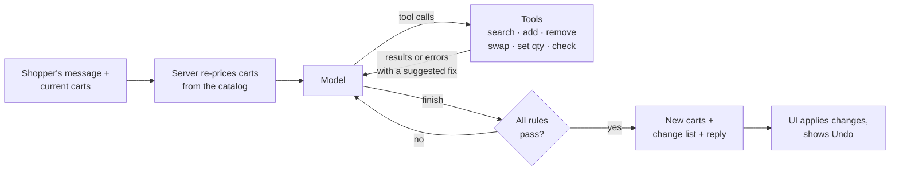

# Cart editor agent: design plan

Nov 9, 2026 · @Ram · **Status: built** (PRs #5–#13). What changed from this plan is at the end.

## Summary

After Jhola builds three carts, the shopper can type a change in plain language under them: *"make cart 2 vegetarian"*, *"I already have rice and oil"*, *"cheaper, under ₹600"*. An agent works out the steps, edits the carts through tools, and shows what changed with one Undo.

Jhola's core rule stays the same: **the model decides, code counts.** The agent never sets a price or writes a cart directly. Every change goes through a tool that checks it against the catalog and the shopper's requirements, and the agent can't finish a turn while a rule is broken.

## Goals

- Handle the follow-up requests shoppers actually make after seeing carts: diet, budget, things they already have, adding, swapping, quantities, and "why" questions.
- Be measurably reliable: a scripted multi-turn eval, with targets, that runs on every PR touching the agent.
- Stay fast and cheap enough for a public demo: one turn in a few seconds, at about a cent.

## Non-goals (for this version)

- Placing orders or touching payment. Checkout stays the existing demo.
- Memory across visits, accounts or preferences. That's the next phase (the household agent).
- Several agents working together. One loop with good tools is enough here.
- Building carts from scratch through chat. The existing pipeline does that well; the agent edits what it built.

## What a shopper can ask

| Kind | Examples | What the agent does |
| --- | --- | --- |
| Diet | "make cart 2 vegetarian", "no eggs", "jain please" | Replaces items that break the diet with suitable ones; records the diet as a requirement |
| Budget | "cheaper", "keep it under ₹600" | Swaps to cheaper packs or brands, drops optional extras; records the budget |
| Already have | "I have rice and oil" | Removes those items |
| Add | "add something for dessert", "and some curd" | Searches and adds a fitting item |
| Swap | "different brand of paneer", "a bigger pack of rice" | Swaps within the same kind of product |
| Quantity | "double the chicken", "just 1 pack of butter" | Changes pack counts (1–10) |
| Question | "why is this one so expensive?", "is this enough for 6?" | Answers from the cart; changes nothing |
| Not possible | "add a laptop", "make it free", "ignore your rules…" | Says what it can't do; changes nothing |

## How a turn works

1. The browser sends the message, the current carts (including the shopper's own manual edits), the requirements, and the last few chat messages.
2. The server **doesn't trust the carts it receives**. It rebuilds them from product IDs and quantities alone, taking every name, price and stock status from the catalog.
3. The model gets the rules, the tools, the carts in a compact form and the conversation. It calls tools until it calls `finish`. It may call several tools at once (for example, two searches), which saves round trips.
4. `finish` re-checks every rule. If one fails, the model gets the problem back and must fix it or explain why it can't.
5. The server returns the new carts, a list of changes per cart, and a short reply. While the turn runs, it streams progress lines ("Searching for paneer…").
6. The browser applies the new carts and keeps the previous ones for Undo.

**The server keeps no state between turns.** The carts live in the browser, as they do today, so the agent doesn't need a database to work, and manual edits and agent edits mix freely. Re-pricing everything on each turn is what makes this safe.

## Tools

The editing tools wrap the functions the UI already uses in [lib/cartState.ts](../lib/cartState.ts) (`setQty`, `removeItem`, `swapItem`, `swapOptions`), so the agent and the shopper's taps follow identical rules.

| Tool | Does | Code checks |
| --- | --- | --- |
| `search_catalog(text, filters)` | Finds products. Filters: diet (veg, vegan, jain), max price, category, in stock only (default) | Returns at most 8, cheapest relevant first, with ID, name, pack, price and tags |
| `get_product(id)` | One product's details | Real ID |
| `add_item(cart, product_id, qty)` | Adds a line | Real ID, in stock, qty 1–10, not already in the cart |
| `remove_item(cart, product_id)` | Removes a line | It's in the cart |
| `swap_item(cart, product_id, new_product_id)` | Replaces a line, keeping the qty | New product in stock, same kind (or the shopper asked for a different kind) |
| `set_qty(cart, product_id, qty)` | Changes the pack count | 1–10 |
| `set_requirements(cart, {diet?, budget_inr?, drop_must_include?})` | Records a new requirement the shopper stated | Values in range |
| `check_rules(cart)` | Lists what currently breaks a rule | none |
| `finish(reply)` | Ends the turn | Refuses while any rule is broken |

Tool errors are written for the model to act on. For example: *"p214 (Amul Paneer 200 g) is out of stock. Closest in stock: p219 Milky Mist Paneer 200 g, ₹99."*

**Search** starts as an in-memory search over the 1,006 products: word matching on name, brand, sub-category and tags, plus the filters. It has the same interface the Postgres keyword-plus-vector search will have later, so it can be swapped in without changing the agent.

**Why a search tool, not the whole catalog in the prompt** (as the cart builder does): an agent turn makes about 3–4 model calls. Sending the 21k-token catalog with each one roughly doubles the cost per turn and slows every step. A search tool also keeps working when the catalog grows 10x.

## Rules the agent must keep

A cart's **requirements** start from the original request (budget, item count, the named main ingredient) and change only through `set_requirements`, when the shopper states something new. After every turn, each edited cart must pass:

- every item real, in stock, quantity 1–10, no duplicate lines;
- prices and totals computed by code from the catalog;
- the budget, if there is one;
- the diet, if there is one (each required item carries the tag: `veg`, `vegan` or `jain`);
- the main ingredient, unless the shopper asked to drop it.

**When a new request conflicts with the old one**, for example "make the chicken biryani vegetarian": the agent does what the shopper asked now, updates the requirements, and says so in its reply ("Swapped chicken for paneer, so it's now a paneer biryani").

Carts are no longer required to differ from each other once the shopper starts editing. They might want two similar ones.

## Limits

| Limit | Value | Why |
| --- | --- | --- |
| Tool calls per turn | 8 | A normal edit takes 2–5; more means the agent is lost |
| Model calls per turn | 5 | Caps cost and latency |
| Time per turn | 25 s | Returns a clear error instead of hanging |
| Repeated identical call | stops the turn | Catches loops |
| Message length | 300 characters | Same as the cart request |
| History sent | last 6 messages | Keeps prompts small; older context rarely matters for edits |
| Rate limit | its own bucket: 30 turns per person per hour, inside the shared daily cap | Chat turns are cheaper and more frequent than cart builds |

If a turn hits a limit, nothing changes and the shopper sees "I couldn't finish that change. Try asking for one thing at a time."

**Which carts it edits:** the cart the shopper is looking at, unless they name another ("cart 2") or say "all of them".

## Model

- `gpt-5.4-mini` through the Responses API with strict function-calling schemas, the same provider and SDK as today.
- No reasoning ("thinking") by default, like the cart pipeline. The eval decides whether some turns, such as multi-constraint budget fits, need a little.
- The model client sits behind an interface, like today's `LlmClient`. Unit tests use a scripted fake model that returns planned tool calls, so the loop, the limits and every error path are tested without API calls.
- Expected cost: about $0.01 per turn (about ₹0.8). Expected latency: 3–6 s for a typical turn.

## Evaluation

A scripted multi-turn eval, run in code like today's eval.

- **Starting carts** are saved snapshots of real cart-builder outputs ("chicken biryani for 6", "monthly groceries under 3000", …), so the eval doesn't call the cart builder and every run starts identical.
- **About 25 scenarios**: diet 5, budget 5, already-have/remove 4, add 4, swap and quantity 3, questions 2, not-possible 2 (including a prompt injection). Some have two turns, to test that context carries over.
- **Each scenario has checks written in code** on the final carts. For example, "make cart 2 vegetarian" checks that every required item in cart 2 is tagged `veg`, that carts 1 and 3 are unchanged, that the main dish still has a protein, and that totals match the catalog.

| Metric | Target |
| --- | --- |
| Task success (all checks pass) | ≥ 90% |
| Rule breaks in final carts | 0 |
| Wrong carts changed | 0 |
| Questions answered with no change | 100% |
| Steps per turn | report (expect 2–5) |
| Tool errors per turn | report |
| Latency p50 / p95 per turn | report / < 10 s |
| Cost per turn | report (expect ~$0.01) |

Six scenarios join the existing PR eval check, with their own baseline, so any PR touching the agent or its prompt is gated the same way the cart builder is.

## Observability

Until the Postgres trace tables exist, each turn writes JSON log lines to the server journal: one per step (model call or tool call), with the trace ID, step name, time, tokens, tool name, and whether it succeeded. The shape matches the planned trace and step tables, so moving them into Postgres later is a change of destination, not a redesign.

## UI

- A chat bar under the carts: "Ask Jhola to change a cart…". On phones, it stays docked at the bottom.
- Suggestion chips based on the carts: "Make it vegetarian", "Under ₹…", "I have the basics".
- While a turn runs, one live line shows what it's doing ("Searching for paneer…").
- Each reply shows its changes ("Cart 2: −Chicken 1 kg, +Paneer 400 g · ₹1,240 → ₹1,085") and an **Undo** button that restores the carts from before that turn.
- The edited lines briefly highlight in the cart cards.

## Security

- Carts from the browser are untrusted: re-priced from the catalog by ID, and unknown IDs are dropped.
- The shopper's message is data, not instructions. The tools can only edit these three carts, so the worst a prompt injection can do is a bad edit the shopper can undo.
- New endpoint `/api/agent`: the same input validation, rate limiting and error handling as `/api/build-carts`. nginx needs its own `location` block with a per-address limit, applied by hand on the server, since deploys don't change nginx.

## Delivery: PR by PR

| PR | What lands | Checked by |
| --- | --- | --- |
| A | The build response includes each cart's requirements; server-side cart re-pricing; a rule checker for edited carts | Unit tests |
| B | `search_catalog` (in-memory, with filters) | Unit tests, plus a small retrieval check ("paneer" finds paneer, veg filter excludes meat) |
| C | Agent core: tools, loop, limits, OpenAI tool calling, step logs | Unit tests with the scripted fake model, covering every limit and error path |
| D | Agent eval: snapshot carts, 25 scenarios, scoring; 6 added to the PR eval check | The eval itself; baseline committed |
| E | `/api/agent` with streaming, rate limit bucket, nginx block | Unit tests; manual nginx step |
| F | Chat UI: input, chips, live status, change list, Undo | Browser check on phone and desktop widths |
| G | Tuning rounds driven by the eval, and a README section with the results table | Eval numbers in each PR |

About two weeks of work. Each PR ships on its own. The agent stays hidden behind a setting until F lands.

## Decisions

Agreed on Nov 9, 2026:

1. **Build order: the agent comes next.** Because carts stay in the browser and the catalog already has diet tags, the agent doesn't need Postgres. Postgres, the catalog pipeline, trace tables and `/stats` follow, with real agent traffic to observe. This replaces the Nov 8 order, which put Postgres first.
2. **Catalog access: a search tool**, not the whole catalog in the prompt. It's about half the cost per turn, faster per step, and works when the catalog grows.
3. **Which carts a turn edits: the one the shopper is looking at**, unless they name another or say "all of them".
4. **Conflicts with the original request: do it and say so.** The agent follows the newest request, updates the cart's requirements, and explains the change. Undo is one tap.

## What changed from the plan

Built as planned in PRs #5–#13, with these differences, each driven by the eval. Every number here was measured with gpt-5.4-mini called on OpenAI directly; since Nov 12, 2026 the same model is called through OpenRouter.

- **More of the work moved into code.** Two tools that weren't in the plan do mechanical work in code instead of in model calls:
  - `cheapen` runs the cart builder's own budget fitting;
  - `fit_diet` swaps items to fit a diet by kind.

  `set_requirements` (planned) also gained a rule: a dropped main ingredient has to name its replacement.
- **Code decides which carts a turn may change**, from the shopper's words, rather than trusting the model to stay in scope. That took "wrong cart changed" to 0.
- **Every editing tool takes a `done` flag.** When the model marks its last edit done and every rule passes, code ends the turn and writes the reply itself. This saves a model call and halved the median turn, from about 4.2 s to 2.3 s. After any refused call the model still writes the reply, so it can say what couldn't be done.
- **Swaps keep the amount**, and a replaced main ingredient must be at least half its weight. Without this, 900 g of chicken became one 200 g pack of paneer.
- **The reply can't mention a rupee amount the agent wasn't shown**, so it can't claim a total it didn't reach.
- **Limits:** 16 tool calls, 6 model calls and 25 s per turn, instead of the planned 8 / 5 / 25 s. Diet changes on all three carts needed the room.
- **Results:**
  - 89–93% on 27 scenarios across runs before the catalog grew to 2,743 products, and 90% on 29 after;
  - 0 rule breaks in every run;
  - about 2.3 s median per turn at about $0.003 on 27 scenarios, and 3.9–4.4 s at $0.0039–0.0051 on the 29 scenarios with the bigger catalog.
- **Later work this plan put off has since shipped:** the request log in Postgres, 👍/👎 feedback and `/stats` (PRs #14–#16), and the bigger catalog with household items (PR #17).
